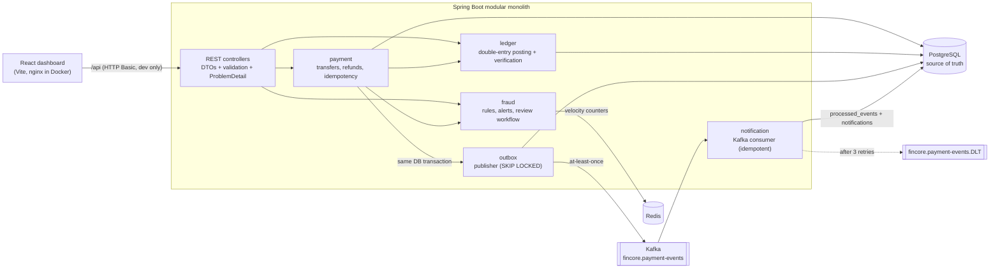

# FinCore

FinCore is a small fintech backend with a React operations dashboard. It is a portfolio and
interview project that shows how to build payments with Java, Spring Boot, PostgreSQL, Redis and
Kafka while keeping the money correct.

> **Simulated money only.** FinCore is for learning. It doesn't connect to any bank, card network
> or payment provider. Do not point it at real accounts or real money.

What it does:

- **Customers and INR accounts.** Accounts can be frozen and unfrozen. Opening balances are posted
  as explicit ledger transactions.
- **Atomic transfers.** Accounts are locked in a fixed order, overdrafts are blocked, and duplicate
  requests are caught by a durable idempotency key with a request fingerprint.
- **Double-entry ledger.** Every transaction must balance, and the database enforces it with a
  deferred trigger. Posted rows can't be changed. The backend can recompute balances and check
  them against the ledger.
- **Refunds.** A refund posts a new, opposite ledger transaction and can never exceed the original
  payment.
- **Fraud screening.** Three configurable rules (high value, velocity counted in Redis, new
  beneficiary) produce APPROVED, REVIEW or DECLINED before any money moves. Analysts review held
  payments.
- **Transactional outbox.** Events are published to Kafka and processed by an idempotent consumer
  with bounded retries and a dead-letter topic.
- **Operations dashboard.** Built with React, Vite, TypeScript and Tailwind, and connected to the
  real APIs.

## Architecture



Payment processing, ledger posting and synchronous fraud screening all run inside one Spring Boot
application and one PostgreSQL transaction. Kafka is only used for downstream processing that
happens after the payment commits. More detail is in [docs/architecture.md](docs/architecture.md).

## Repository layout

```
backend/          Spring Boot 4.1 / Java 21 application (Maven wrapper, Dockerfile)
  src/main/java/com/fincore/
    account/ customer/ payment/ ledger/ fraud/ idempotency/ outbox/ notification/ dashboard/ config/ common/
  src/main/resources/db/migration/   Flyway V1..V4
frontend/         React 19 + Vite 8 + TypeScript + Tailwind 4 dashboard (Dockerfile, nginx.conf)
infrastructure/   docker-compose.yml (PostgreSQL, Redis, Kafka, backend, frontend)
docs/             architecture.md, interview-guide.md
PROGRESS.md       Phase-by-phase log with actual test results
```

## Prerequisites

| Tool | Version used | Needed for |
|---|---|---|
| JDK | 21 | backend (the Maven wrapper downloads Maven 3.10) |
| Docker + Docker Compose | Docker 29 / Compose v5 | infrastructure, Testcontainers, full stack |
| Node.js + npm | Node 22 / npm 10 | dashboard development |

## Quick start: everything in Docker

```bash
docker compose -f infrastructure/docker-compose.yml up -d --build
```

- Dashboard: http://localhost:3000. Sign in as `analyst` / `analyst-dev-password`, or as
  `operator` / `operator-dev-password`, who can't make review decisions.
- API: http://localhost:8080. Swagger UI is at http://localhost:8080/swagger-ui.html and the
  OpenAPI JSON at `/v3/api-docs`.
- Health: http://localhost:8080/actuator/health

The Compose backend sets `FINCORE_DEMO_SEED=true`, which creates four demo customers and accounts
(Asha ₹5,00,000, Rohan ₹2,50,000, Meera ₹50,000, Vikram ₹1,000) through the normal services.
It only does this when the database is empty.

Stop the stack with `docker compose -f infrastructure/docker-compose.yml down`. Add `-v` to also
delete the PostgreSQL volume.

## Local development

Start only the infrastructure:

```bash
docker compose -f infrastructure/docker-compose.yml up -d postgres redis kafka
```

Run the backend. Kafka is reachable from the host on port 9094:

```bash
cd backend
FINCORE_KAFKA_BOOTSTRAP_SERVERS=localhost:9094 FINCORE_DEMO_SEED=true ./mvnw spring-boot:run
```

Run the dashboard. Vite proxies `/api` to `http://localhost:8080`:

```bash
cd frontend
npm install
npm run dev
```

Then open http://localhost:5173.

## Environment variables

| Variable | Default | Purpose |
|---|---|---|
| `FINCORE_DB_URL` | `jdbc:postgresql://localhost:5432/fincore` | PostgreSQL JDBC URL |
| `FINCORE_DB_USER` / `FINCORE_DB_PASSWORD` | `fincore` / `fincore` | Database credentials |
| `FINCORE_DB_POOL_SIZE` | `20` | Hikari pool size |
| `FINCORE_REDIS_HOST` / `FINCORE_REDIS_PORT` | `localhost` / `6379` | Redis for velocity counters |
| `FINCORE_KAFKA_BOOTSTRAP_SERVERS` | `localhost:9092` | Kafka bootstrap servers (use `localhost:9094` with the Compose broker) |
| `FINCORE_OUTBOX_PUBLISHER_ENABLED` | `true` | Run the scheduled outbox relay |
| `FINCORE_CONSUMER_ENABLED` | `true` | Run the in-process Kafka consumer |
| `FINCORE_DEMO_SEED` | `false` | Seed demo customers and accounts into an empty database |
| `FINCORE_OPERATOR_USER` / `FINCORE_OPERATOR_PASSWORD` | `operator` / `operator-dev-password` | Dev user with the OPERATOR role |
| `FINCORE_ANALYST_USER` / `FINCORE_ANALYST_PASSWORD` | `analyst` / `analyst-dev-password` | Dev user with the ANALYST and OPERATOR roles |
| `FINCORE_LOGIN_MAX_FAILURES` | `10` | Failed sign-ins per IP in 15 minutes before HTTP 429 |
| `FINCORE_ALLOWED_ORIGINS` | `http://localhost:5173` | CORS origins, comma separated |
| `FINCORE_PORT` | `8080` | HTTP port |

Fraud thresholds, outbox retry settings and consumer retry settings are under `fincore.*` in
[application.yml](backend/src/main/resources/application.yml). You can override any of them with
standard Spring relaxed binding, for example `FINCORE_FRAUD_REVIEWTHRESHOLD=50`.

### Authentication (local development only)

The backend uses stateless HTTP Basic with two in-memory users. The dashboard keeps the Basic
credentials in `sessionStorage` for the life of the tab. This is **not production
authentication**: there is no user store, password rotation, MFA, session revocation or audit of
logins, and credentials travel with every request (use TLS outside localhost). A real deployment
would use an identity provider (OIDC) and the OAuth2 resource server.

- `OPERATOR` can use every endpoint except fraud review decisions.
- `ANALYST` can do everything an operator can, plus `PATCH /api/v1/fraud/alerts/{id}/status`.

## API

All endpoints are under `/api/v1`. Errors come back as RFC 9457 problem details with a stable
`code`, such as `INSUFFICIENT_FUNDS`, `IDEMPOTENCY_KEY_REUSED` or `INVALID_ALERT_TRANSITION`.

| Method | Path | Notes |
|---|---|---|
| POST | `/customers` | Create a customer. Duplicate email returns 409 |
| GET | `/customers`, `/customers/{id}` | List or get customers |
| POST | `/accounts` | `{customerId, displayName, openingBalance?}`. The opening balance is posted as a ledger transaction |
| GET | `/accounts?customerId=`, `/accounts/{id}` | List or get accounts |
| GET | `/accounts/{id}/balance` | Current balance |
| POST | `/accounts/{id}/freeze`, `/accounts/{id}/unfreeze` | Frozen accounts can neither send nor receive |
| POST | `/payments` | **Requires the `Idempotency-Key` header** (8 to 100 chars). Returns 201 when new, or 200 with `Idempotent-Replayed: true` on a replay. A different payload for the same key returns 409 |
| GET | `/payments?accountId=&status=&page=&size=` | Payment history, newest first |
| GET | `/payments/{id}` | Payment status, fraud score, decision and rules |
| POST | `/payments/{id}/refund` | **Requires `Idempotency-Key`.** `{amount?, reason?}`. If `amount` is omitted, the full remaining amount is refunded |
| GET | `/payments/{id}/refunds` | Refunds of a payment |
| GET | `/payments/{id}/ledger` | Ledger transactions (transfer and refunds) with their entries |
| GET | `/accounts/{id}/ledger` | Ledger history of one account |
| GET | `/accounts/{id}/balance/verification` | Stored balance compared with Σcredits − Σdebits |
| GET | `/ledger/entries?accountId=&paymentId=&direction=&transactionType=&from=&to=` | Ledger search used by the explorer |
| GET | `/ledger/verification` | Whole-ledger integrity check |
| GET | `/fraud/alerts?status=&decision=&paymentId=` | Alerts, including allowed transitions |
| GET | `/fraud/alerts/{id}` | One alert |
| PATCH | `/fraud/alerts/{id}/status` | `{status, note?}`. ANALYST role only |
| GET | `/accounts/{id}/notifications` | Notifications written by the Kafka consumer |
| GET | `/dashboard/summary` | Counters and recent payments for the overview page |
| GET | `/me` | Current user and roles |

### What a payment returns

Business outcomes are returned as a persisted payment `status`, not as HTTP errors.

| Status | Meaning | Money moved? | Ledger? |
|---|---|---|---|
| `COMPLETED` | Fraud APPROVED, balances updated | yes | TRANSFER posted |
| `PENDING_REVIEW` | Fraud REVIEW. Held until an analyst decides | no | none |
| `DECLINED` | Fraud DECLINED, or rejected after review | no | none |
| `FAILED` | Approved but not executable (`INSUFFICIENT_FUNDS`, `ACCOUNT_FROZEN`) | no | none |
| `PARTIALLY_REFUNDED` / `REFUNDED` | Completed payment with refunds | yes | TRANSFER + REFUND(s) |

Validation errors (400), unknown accounts (404) and system-account misuse (422) roll the whole
transaction back, including the idempotency-key claim, so the client can retry with the same key.

## Database migrations

Flyway runs automatically at startup. Hibernate is set to `ddl-auto: validate`, so it never
changes the schema.

| Migration | Contents |
|---|---|
| `V1__customers_and_accounts.sql` | customers, accounts, no-overdraft `CHECK`, system funding account |
| `V2__payments_ledger_idempotency.sql` | payments, idempotency_keys, ledger tables, immutability triggers, deferred double-entry trigger |
| `V3__refunds_and_fraud.sql` | refunds, fraud columns on payments, fraud_alerts |
| `V4__outbox_and_consumer.sql` | outbox_events, processed_events, payment_notifications |

## Fraud rules

The rule scores are added together, and the total is compared with the thresholds. These are the
defaults from `application.yml`:

| Rule | Trigger | Score |
|---|---|---|
| `HIGH_VALUE` | amount ≥ ₹1,00,000 | 50 |
| `VELOCITY` | more than 5 payment attempts from the same source account within 60 s (Redis) | 40 |
| `NEW_BENEFICIARY` | no previously settled payment from this source to this destination | 20 |

A score of 40 or more means **REVIEW**, and 70 or more means **DECLINED**. For example:

- A small payment to a new payee scores 20 and is APPROVED.
- ₹1.2 lakh to a known payee scores 50 and goes to REVIEW.
- ₹1.5 lakh to a new payee scores 70 and is DECLINED.

**When Redis is unavailable**, the velocity rule can't be evaluated. The rule
`VELOCITY_CHECK_UNAVAILABLE` is recorded and the decision is raised to at least
`fincore.fraud.velocity.unavailable-decision`. The default is REVIEW, and DECLINED can be
configured. Configuring APPROVED fails validation at startup. Redis calls time out after 500 ms.
This is tested (`FraudServiceTest`, `VelocityTrackerTest`, `RedisOutageTest`) and was also checked
manually by stopping the Redis container: the payment came back `PENDING_REVIEW` in under a second.

**Review workflow.** Alerts are created for REVIEW and DECLINED decisions.

- A REVIEW alert can go `OPEN → IN_REVIEW → APPROVED | REJECTED`. APPROVED executes the held
  transfer and re-checks funds and frozen status under lock, so the payment may still end FAILED.
  REJECTED declines it.
- A DECLINED alert can only be `CLOSED`. The payment stays declined.
- Invalid transitions return 409. The alert row is locked, so concurrent approvals execute the
  payment at most once.

## Payment and ledger invariants

1. **Balance convention.** For every account, balance = Σ CREDIT − Σ DEBIT. Customer accounts are
   deposit liabilities: a credit increases the customer's balance.
2. **Double entry.** Every ledger transaction has at least two entries and Σ debits = Σ credits.
   Java checks this before posting, and a `DEFERRABLE INITIALLY DEFERRED` constraint trigger checks
   it again at COMMIT.
3. **Immutability.** UPDATE and DELETE on `ledger_entries` and `ledger_transactions` are rejected
   by triggers. Corrections are new compensating transactions.
4. **Opening balances.** Each one is an `OPENING_BALANCE` transaction: DEBIT the system funding
   account, CREDIT the new account. The system account is the only one allowed to go negative.
5. **No overdraft.** Funds are checked under a `SELECT … FOR UPDATE` lock, and
   `CHECK (account_type = 'SYSTEM' OR balance >= 0)` backs this up in the database.
6. **Atomicity.** The idempotency key, payment row, fraud decision and alert, balance updates,
   ledger entries and outbox event are written in **one** PostgreSQL transaction.
7. **Refund bounds.** `0 ≤ refunded_amount ≤ amount` is enforced by a `CHECK`. The application
   also checks it while holding the payment row lock.
8. **Settled payments have a ledger.** Every COMPLETED or REFUNDED payment has exactly one
   TRANSFER transaction. Ledger verification reports any violation.

## Testing

```bash
cd backend && ./mvnw test        # needs Docker running (Testcontainers)
cd frontend && npm run build     # type-check + production build
```

The integration tests start real **PostgreSQL 16, Redis 7 and Kafka 3.8** containers, shared for
the whole run. The last full run executed **65 tests: 65 passed, 0 failed**.

| Test class | Tests | What it covers |
|---|---|---|
| `AccountApiTest` | 5 | Customer and account APIs, validation, 401, freezing |
| `PaymentIntegrationTest` | 9 | Successful transfer, opening balance, insufficient funds, frozen accounts, idempotent replay, 409 on payload mismatch, key not consumed on validation error |
| `PaymentConcurrencyTest` | 3 | 10 concurrent withdrawals (exactly 5 succeed), opposite-direction transfers without deadlock, 8 concurrent requests with the same key execute once |
| `LedgerIntegrityTest` | 5 | Rollback after failure, unbalanced transaction rejected at COMMIT, immutability triggers, mismatch detection |
| `PaymentApiTest` | 2 | HTTP-level 201/200/409/400, ledger, verification and dashboard endpoints |
| `RefundIntegrationTest` | 6 | Full and partial refunds, refund bounds, duplicate refund replay, concurrent refunds, refund of a payment that can't be refunded, payee without funds |
| `FraudServiceTest` (unit) | 9 | Scoring, thresholds, Redis-unavailable policy |
| `FraudPropertiesValidationTest` (unit) | 3 | Invalid fraud configuration (e.g. approving when Redis is down) fails startup |
| `VelocityTrackerTest` | 3 | 50 concurrent increments with no loss, TTL and window reset, connection refused |
| `FraudWorkflowTest` | 9 | REVIEW moves no money, approve executes once (also concurrently), reject, re-check on approval, DECLINED, velocity through Redis, new beneficiary, analyst-only PATCH |
| `RedisOutageTest` | 1 | Payment held for REVIEW when Redis fails |
| `OutboxPublisherTest` (unit) | 5 | Success headers, exponential backoff, parking as FAILED, pipelined batch with partial failure, stop sending when Kafka is unreachable |
| `OutboxKafkaIntegrationTest` | 5 | Outbox written only on commit, consume, duplicate publication and delivery have no second effect, refund events, malformed message sent to DLT, bounded retries then DLT |

The concurrency tests found a real bug during development. A repository
`SELECT … FOR UPDATE` returned a stale entity that was already in the JPA persistence context,
which caused lost updates. See `RowLocks` and the interview guide.

## Load test

k6 was run against the Docker Compose stack on one laptop (Ryzen 7 6800HS). Full details,
caveats and raw output are in [loadtest/RESULTS.md](loadtest/RESULTS.md).

- **~1,000 payments/s, p95 87 ms, 0 errors** with 50 virtual users over 100 accounts and BCrypt
  strength 4. With the default strength 10 it was ~161/s, because HTTP Basic re-hashes the
  password on every request.
- **No overdraft under contention.** With 50 users debiting one account (~265/s), 3,998 debits
  succeeded until the funds ran out and 11,885 were rejected as insufficient funds.
- **Integrity across 211,878 payments.** The ledger verified VALID (200,563 transactions), and all
  199,993 completed payments were published and consumed with 0 duplicate effects.
- **Bottleneck found and fixed.** The outbox relay drained ~133 events/s because it awaited each
  Kafka ack in turn. Pipelining raised it to >2,800 events/s.

## Known limitations

- **Authentication** is for local development only (see above).
- **Velocity** uses a fixed window. A burst that straddles the window boundary can reach almost
  twice the limit. The counter counts attempts, including ones whose database transaction later
  rolls back.
- **Held payments don't reserve funds.** Approval re-checks the balance and may fail. Holds never
  expire.
- **Outbox ordering.** Events are published in creation order. If one event is waiting in backoff,
  a later event for the same payment, such as a refund, can be published first. The consumer
  handles each event independently.
- **Outbox failures need manual handling.** Rows parked as `FAILED` after `max-attempts` have no
  admin endpoint for replay. The publisher holds the batch's row locks while it awaits Kafka
  acknowledgements (bounded by a 10 s send timeout).
- **Consumer lag under peak load.** The in-process consumer shares CPU and database with the
  payment path. At ~870 payments/s on one laptop it fell behind and caught up 46 s after the load
  ended (see loadtest/RESULTS.md).
- **The consumer runs in the same JVM** for simplicity. It only uses its own tables, so it could be
  moved to its own process.
- **Idempotent replays return the payment's current state** (for example REFUNDED), not a byte-for-byte
  copy of the first response.
- **Refunds need the payee to still hold the funds**, and both accounts must be active. There are
  no negative balances or debt collection.
- **Opening balances lock one row.** All of them lock the system funding account, which is fine at
  this scale.
- **The fraud alert list makes one extra query per row** to load the payment summary (N+1).
- **Single currency (INR), no fees, FX, scheduled payments or statements.**
- **Rate limiting is basic.** nginx limits each IP to 20 API requests/s (bursts of 40), and the backend
  blocks an IP for 15 minutes after 10 failed sign-ins (Redis counter; fails open if Redis is down).
  There are no per-user quotas.
- **Load-test numbers are from one laptop** with every component co-located. They are not production capacity figures.

## Further reading

- [docs/architecture.md](docs/architecture.md) covers module boundaries, transaction flow, locking
  and delivery semantics.
- [docs/interview-guide.md](docs/interview-guide.md) explains the concepts behind each design
  decision.
- [PROGRESS.md](PROGRESS.md) records what was built in each phase and the actual test results.
