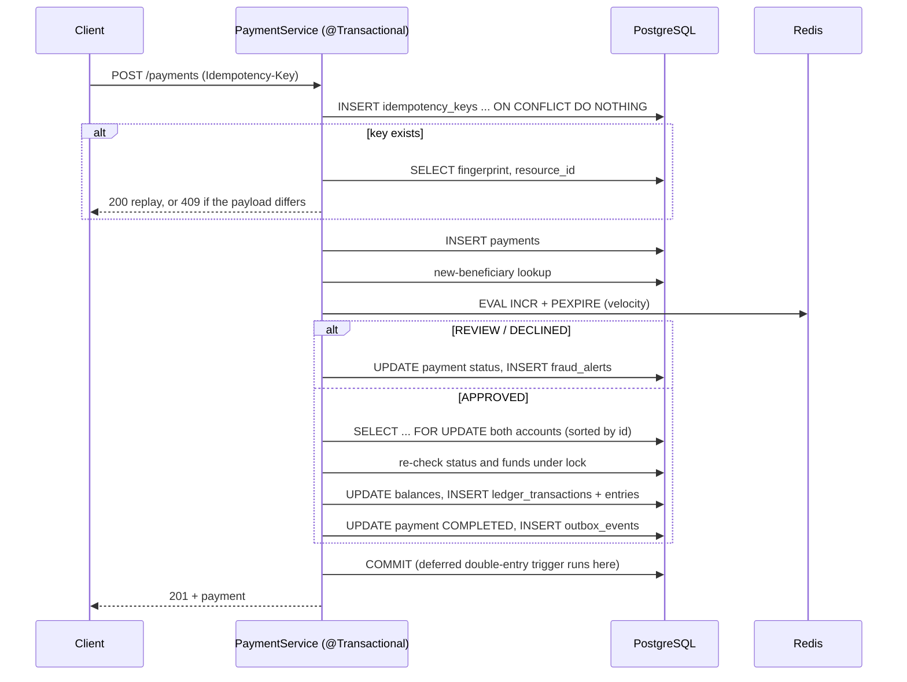

# FinCore architecture

FinCore is a modular monolith: one Spring Boot application, with one package per business
module. PostgreSQL is the only authoritative store. Redis holds short-lived fraud counters.
Kafka carries events to downstream consumers after the business transaction has committed.

## Modules

| Package | Responsibility | Owns tables |
|---|---|---|
| `customer` | Customer records | `customers` |
| `account` | Accounts, freeze/unfreeze, deterministic multi-account locking, opening balances | `accounts` |
| `ledger` | The only writer of ledger rows; history, search and verification | `ledger_transactions`, `ledger_entries` |
| `idempotency` | Claiming request keys, fingerprints, replay lookup | `idempotency_keys` |
| `payment` | Transfer orchestration, refunds, releasing and rejecting held payments | `payments`, `refunds` |
| `fraud` | Rule scoring, Redis velocity, alerts, review workflow | `fraud_alerts` |
| `outbox` | Recording and relaying integration events | `outbox_events` |
| `notification` | Kafka consumer (the downstream "service") | `processed_events`, `payment_notifications` |
| `dashboard` | Read-only aggregates, optional demo seed data | none |
| `common`, `config` | Errors, money helpers, row locking, security, OpenAPI, Kafka config | none |

Dependencies point one way: `payment` → `fraud` / `ledger` / `account` / `idempotency` / `outbox`.
`fraud.FraudReviewService` calls back into `payment` to release a held payment.
`FraudService` reads beneficiary history with SQL instead of depending on the payment module.
`notification` depends only on the event contract (`events.PaymentEvent`).

## Accounting convention

- Every account obeys **balance = Σ CREDIT − Σ DEBIT**.
- Customer accounts are deposits, which are liabilities of the simulated bank. A CREDIT increases
  what the bank owes the customer, which is the customer's balance.
- The **system funding account** (`00000000-0000-0000-0000-000000000001`) is the counterparty for
  opening balances. Its balance goes negative by exactly the total money injected into the
  simulation, so Σ of all account balances is always 0.

| Ledger transaction | DEBIT | CREDIT |
|---|---|---|
| `OPENING_BALANCE` | system funding account | new customer account |
| `TRANSFER` | payer | payee |
| `REFUND` | original payee | original payer |

`accounts.balance` is a materialised running total. It only changes inside
`LedgerService.post`, in the same transaction as the entries. That is what makes reconciliation
(stored balance compared with the ledger sum) meaningful.

## Payment request: one transaction

Fraud screening runs **before** any balance change. A REVIEW decision holds the payment with no
debit and no ledger transaction. The transfer is posted only if an analyst approves it, and
`settle()` then re-checks funds and frozen status under the account locks.

## Concurrency control

- **Pessimistic row locks** (`SELECT … FOR UPDATE`) on both accounts, taken in a deterministic
  order: by UUID string, which matches PostgreSQL's uuid ordering. Two transfers in opposite
  directions both lock the lower id first, so they can't deadlock. `PaymentConcurrencyTest`
  verifies this.
- **Locks with a fresh read.** `RowLocks.lockForUpdate` refreshes a managed entity with
  `PESSIMISTIC_WRITE`. A plain locking query would return a stale cached entity if it was loaded
  earlier in the same persistence context, and the next flush would cause a lost update. The
  concurrency test caught exactly this.
- **Payment row lock** for refunds and review decisions, so concurrent refunds can't both pass the
  remaining-amount check.
- **Alert row lock** for review decisions, so concurrent approvals execute the payment once.
- **Idempotency** relies on the primary-key unique index. A concurrent duplicate INSERT blocks
  until the first transaction commits or rolls back.
- **Lock timeout** is 5 s (`jakarta.persistence.lock.timeout`).
- **Read-side verification** (balance reconciliation, ledger verification, dashboard) runs in
  `REPEATABLE READ` read-only transactions, so every query in one check sees the same snapshot.

## Database-level guarantees

The application enforces the important rules, and the schema enforces them again:

- `CHECK (account_type = 'SYSTEM' OR balance >= 0)` prevents overdrafts.
- `CHECK (refunded_amount BETWEEN 0 AND amount)` bounds refunds.
- `CHECK (amount > 0)` applies to payments, refunds and ledger entries.
- A deferred constraint trigger enforces `Σ debits = Σ credits` and at least two entries per
  ledger transaction, at COMMIT.
- `BEFORE UPDATE OR DELETE` triggers make the ledger append-only.
- `UNIQUE (payment_id)` on fraud alerts, `PRIMARY KEY (consumer, event_id)` on processed events,
  and `UNIQUE (event_id, account_id)` on notifications.

## Events: outbox and Kafka

1. `PaymentService.settle` and `RefundService.refund` call `OutboxService.record`, which requires
   an existing transaction (`Propagation.MANDATORY`). The event row commits **if and only if** the
   transfer or refund commits.
2. `OutboxScheduler` polls every second. `OutboxPublisher.publishBatch` claims due rows with
   `FOR UPDATE SKIP LOCKED`, so multiple instances don't block or double-claim each other. It
   sends each row synchronously (`acks=all`, idempotent producer, 10 s timeout) with key =
   payment id and an `eventId` header, then marks the row PUBLISHED.
3. When a send fails, `attempts` is incremented and `next_attempt_at` is set to now +
   1 s × 2^(attempts−1), capped at 5 min. After 10 attempts the row is parked as `FAILED`.
   A batch stops at the first failure.
4. The consumer (`PaymentEventListener` → `PaymentEventHandler`) inserts
   `processed_events(consumer, event_id)` with `ON CONFLICT DO NOTHING`, then writes the
   notifications, all in one transaction. If the event was already processed, it is skipped.
5. Errors: `DefaultErrorHandler` retries 3 times, 500 ms apart, then `DeadLetterPublishingRecoverer`
   publishes to `fincore.payment-events.DLT`. JSON and validation errors aren't retried.
   The listener commits each record's offset after processing (`ack-mode: record`).

### Delivery semantics

- **Producer side: at-least-once.** If the process dies after Kafka acknowledges a record but
  before the PUBLISHED update commits, the row is still PENDING and is sent again.
- **Consumer side: at-least-once delivery, effectively-once effect.** If the database commit
  succeeds but the offset commit doesn't, the record is redelivered. The `processed_events` marker
  makes the second attempt a no-op. If processing fails, the marker and the effect roll back
  together.
- FinCore does **not** use Kafka transactions or exactly-once semantics (EOS). Exactly-once across
  PostgreSQL and Kafka would need a distributed transaction. The outbox plus idempotent consumers
  give the same business outcome with simpler machinery.
- **Ordering** is per partition, and the key is the payment id. Retry backoff can reorder events
  of the same payment (see the README limitations).

## Failure modes

| Failure | Behaviour |
|---|---|
| Crash in the middle of a payment | Whole transaction rolls back: no payment, ledger, outbox row or key |
| Duplicate HTTP request | Replayed (200) or 409 if the payload differs; never a second transfer |
| Redis down | Velocity rule can't run; decision raised to REVIEW (configurable to DECLINED); 500 ms timeout |
| Kafka down | Payments still commit; outbox rows accumulate as PENDING and are retried with backoff |
| Duplicate Kafka delivery | Consumer de-duplicates on `(consumer, event_id)` |
| Poison message | Sent to DLT without retries |
| Persistent consumer failure (e.g. DB constraint) | 3 retries, then DLT; no partial effect |
| Two analysts approve together | Alert row lock; the second gets 409 |
